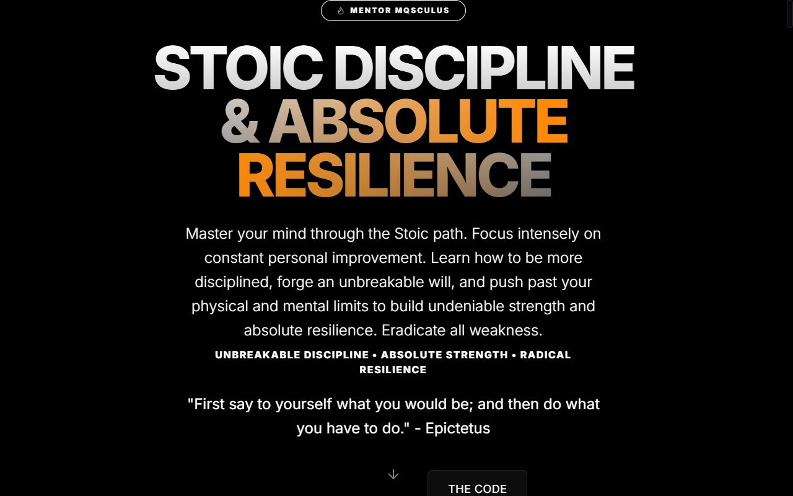
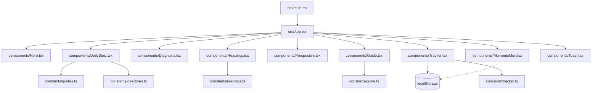

<div align="center">

# 🏛️ Mqsculus Protocol (2026 Life Reset)

**Um dashboard implacável para estoicismo, aprimoramento pessoal, disciplina e resiliência.**<br/>
Tudo roda no navegador: sem conta, sem backend, progresso salvo localmente.

[](https://argocd.antonio-code.duckdns.org)
[](LICENSE)

<br/>



</div>

## 📝 Descrição

O **Mqsculus Protocol** é um painel de controle de alta performance desenvolvido com React e Vite, com foco total em **estoicismo, aprimoramento pessoal, construção de disciplina e força mental e física**.

O aplicativo rejeita o caminho fácil e incentiva o usuário a ser mais disciplinado, forte e resiliente através de princípios como *Amor Fati*, *Memento Mori* e *Premeditatio Malorum*. Ele oferece visualizações dinâmicas e acompanhamento de rotinas focadas em forjar uma mente inabalável.

## 🛠️ Tech Stack

- **Frontend**: [React 18](https://react.dev/)
- **Bundler**: [Vite](https://vite.dev/)
- **Estilização**: [Tailwind CSS v4](https://tailwindcss.com/)
- **Ícones**: [Lucide React](https://lucide.dev/)
- **Efeitos**: [canvas-confetti](https://www.npmjs.com/package/canvas-confetti)

## 🧭 Como Funciona

Cada seção da página é um componente montado em `src/App.tsx`. Conteúdo estático (citações, diretivas, leituras, guia e hábitos) fica em `src/constants/`. O estado do usuário (data, hábitos marcados, streak e Memento Mori) é gravado no `localStorage` do navegador.



## 🚀 Como Rodar Localmente

Pré-requisitos: Node.js (o `Dockerfile` usa Node 20) e pnpm 8.14.3 (campo `packageManager` do `package.json`).

1. Clone o repositório:
   ```bash
   git clone https://github.com/juninmd/super-man.git
   ```
2. Instale as dependências:
   ```bash
   pnpm install
   ```
3. Inicie o servidor de desenvolvimento:
   ```bash
   pnpm run dev      # Vite em modo dev, com hot reload
   ```
4. Gere o build de produção e visualize-o:
   ```bash
   pnpm run build    # tsc + vite build, saída em dist/
   pnpm run preview  # serve o dist/ gerado pelo build
   ```

> [!NOTE]
> Os dados de progresso ficam no `localStorage` deste navegador. Limpar os dados do site apaga o progresso.

## ⚠️ Limitações Conhecidas

- Não há backend, conta nem sincronização entre dispositivos ou navegadores.
- O contador do Memento Mori usa a média estatística de 80 anos, uma estimativa e não uma previsão.
- Não há testes automatizados no repositório.

## 📦 Deployment

Este projeto é implantado via **ArgoCD** no cluster **K3s**.

- **URL de Produção**: [https://super-man.antonio-code.duckdns.org](https://super-man.antonio-code.duckdns.org)

## 📄 Licença

MIT, conforme o badge acima. O arquivo `LICENSE` ainda não existe no repositório.
